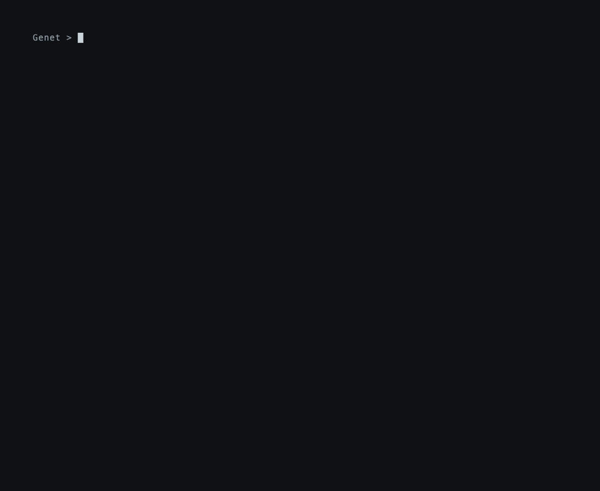

**English** | [简体中文](./README.zh-CN.md)

<div align="center">


# unbury

*One-command answer cards for finished coding agent sessions.*


Your coding agent just fixed the bug — then buried the answer under a thousand lines of reasoning and raw tool output. `unbury` reads the finished **Claude Code** or **Codex** session and renders a one-screen answer card with jump-links into the transcript evidence, so you stop scrolling — or paying to re-ask a question the agent already answered.

<p>
<a href="https://github.com/SuperMarioYL/unbury/actions/workflows/ci.yml"></a>
<a href="https://www.python.org/"></a>
<a href="./LICENSE"></a>


</p>

</div>

##  Demo — the whole pitch in 22 seconds

<p align="center">

</p>

This is a real recording, not a mock: the tape drove the actual `unbury` binary over a real finished Claude Code session on a real project — 53 turns, 426 KB of JSONL. The recorded commands and facts live in [`docs/demo-results.json`](docs/demo-results.json); the recipe that renders the GIF is [`docs/demo.tape`](docs/demo.tape).

What you see, in order:

1. `unbury list` — the finished sessions recorded for that directory, across both agents.
2. The transcript as it exists on disk — the answer is in there, somewhere.
3. `unbury --session 82ed5a79` — one command, one screen: the conclusion, quoted verbatim, plus evidence rows (files edited, commands run, decisions made), each ending in a `:line` ref into that JSONL.
4. `unbury --html` — the same card plus `unbury-answer.html`: the full transcript with a stable anchor on every turn, and every card row deep-linked to the exact turn it came from. Click a row, land on the line.

##  Why

A finished coding-agent session is a strange artifact. The work is done and the conclusion exists — but it is one untyped sentence floating between tool calls, in a transcript written for the *model*, not for you. Until now your recovery options were the terminal scrollback (minutes of squinting) or re-asking the agent (duplicate tokens for an answer it already produced, and a summary that can drift from what it actually said).

unbury's place among the alternatives:

| You want… | Reach for | Why not unbury |
| --- | --- | --- |
| The *next* session to lead with the answer | prompt-rule / output-format skills | Those work at generation time; unbury cannot change what already happened |
| History compressed so the model can continue | built-in summaries (`/compact` and friends) | Aimed at the model's context budget: lossy in the dimensions a human needs, no evidence links |
| To browse a transcript interactively | transcript viewers | You still have to find the answer yourself |
| The conclusion of a finished session, with proof | **unbury** | One command, any finished Claude Code or Codex session, every claim linked to its line |

Two decisions worth stating outright:

- **Verbatim, not re-summarized.** The conclusion is the agent's final answer, extracted as-is by heuristics. No model call, no API key, works entirely offline — and no summary drift.
- **Jump-links are the product, not garnish.** A card that misstates the conclusion is worse than scrollback. That is why every row carries its `path:line`, and why `--html` turns each into a click.

##  How it works

One process, four stages, no network:

```
~/.claude/projects/**/*.jsonl    ~/.codex/sessions/**/*.jsonl     (logs the agents already write)
                 \                 /
              discover — the newest finished session for this directory
                              |
              parsers — claude · codex: dialect JSONL → normalized turns
                              |
              extract — conclusion + evidence → AnswerCard
                              |
      render — one-screen card        htmlview — linked transcript (anchors)
```

The core primitive is the **AnswerCard** — a typed, provenance-linked conclusion over a finished session:

```python
SessionRef { agent, path, turns }
Evidence   { kind: "file" | "command" | "decision",
             summary, ref: (path, line) }
AnswerCard { session: SessionRef,
             conclusion: str,          # final assistant answer, verbatim
             evidence: list[Evidence] } # ordered, deduped
```

Parsers normalize each agent's dialect into shared turns, so extraction and rendering never know which agent produced a session. Two dialect details worth knowing:

- **Finished, not live.** A Claude Code session counts as finished when no running process owns it (checked by pid). A Codex rollout counts as finished after its file has been quiet for five minutes. Either way, unbury never cards the session you are currently in.
- **Codex hides its edits.** Current Codex sessions record file edits only as JS strings inside `exec` tool-call inputs (`tools.apply_patch('…')`); there are no structured apply_patch calls to read. The codex parser decodes those string literals to recover file-edit evidence.

##  Quickstart

Under a minute, nothing to configure:

```bash
uv tool install git+https://github.com/SuperMarioYL/unbury   # or: pipx install git+https://github.com/SuperMarioYL/unbury
```

Then, in the directory where you ran the agent:

```bash
unbury          # the answer card for its newest finished session
unbury --html   # same card, plus unbury-answer.html with jump-links
```

No API key, no settings file, no daemon — unbury only reads the session logs Claude Code (`~/.claude/projects/`) and Codex (`~/.codex/sessions/`) already write to disk.

To hack on it instead:

```bash
git clone https://github.com/SuperMarioYL/unbury && cd unbury
uv tool install .        # or: pip install -e .
pytest                   # parser/extraction/view suites, synthetic fixtures
```

##  Usage

The entire tuning surface is one command and three flags:

```bash
unbury                        # answer card: newest finished session in this directory
unbury list                   # the finished sessions recorded for this directory
unbury --session 82ed5a79     # pick one: session id (see list), unique prefix, or transcript path
unbury --agent claude         # only claude | codex; default: both
unbury --html                 # also write unbury-answer.html (linked transcript view)
```

`--session` reaches across directories, so the backlog of sessions you finished weeks ago is still one prefix away — run `unbury list` inside the project to see what is there. That is the whole interface; anything harder belongs in an issue, not a config file.

##  Supported agents

| Agent | Sessions read from | Finished means | Notes |
| --- | --- | --- | --- |
| Claude Code | `~/.claude/projects/<project>/<id>.jsonl` | no live process owns it | session titles, tool calls, human-vs-injected message filtering |
| Codex | `~/.codex/sessions/**/rollout-*.jsonl` | file quiet ≥ 5 min, not a subagent thread | file edits recovered from `apply_patch` strings inside `exec` inputs |

More agents ride the same seam: a parser is one module that turns a dialect JSONL file into `unbury.parsers`' normalized turns (`parse_session(path) -> ParsedSession`). Discovery, extraction, and both renderers stay agent-agnostic.

##  Limitations

- Extraction is heuristic, not model-backed — that is what keeps unbury zero-config and offline, and why the conclusion is quoted verbatim rather than rewritten.
- Agent log formats are undocumented and change without notice. Parsers are fixture-tested per dialect, and unparseable lines are counted and skipped, never fatal.
- The card shows the rows that fit and says how many more exist; the full evidence table is always in the HTML view.

##  Roadmap

- **More parsers** — Astra, Gemini CLI, Cursor — each a small module over the parser interface, with a fixture format contributors can record from their own sessions.
- **A parser contribution guide** — the recorded-fixture pattern the test suite uses, written down for new agents.
- **Explicitly not planned:** LLM-backed summarization. Zero config — no key, offline, verbatim — is the product.

##  License

[MIT](./LICENSE) © 2026 SuperMarioYL. Section icons are from [Tabler Icons](https://tabler.io/icons) (MIT).

<p align="center"><sub><a href="./LICENSE">MIT</a> © 2026 SuperMarioYL</sub></p>
